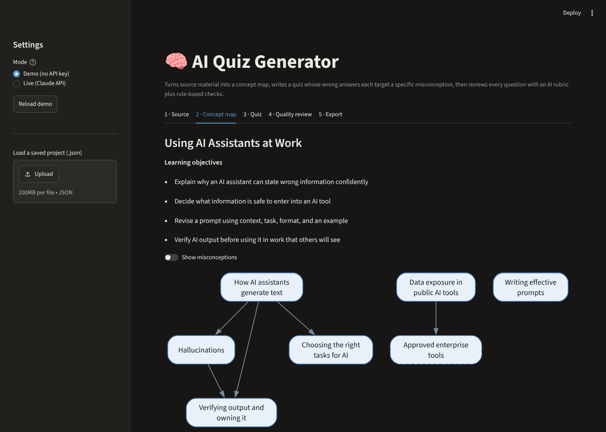
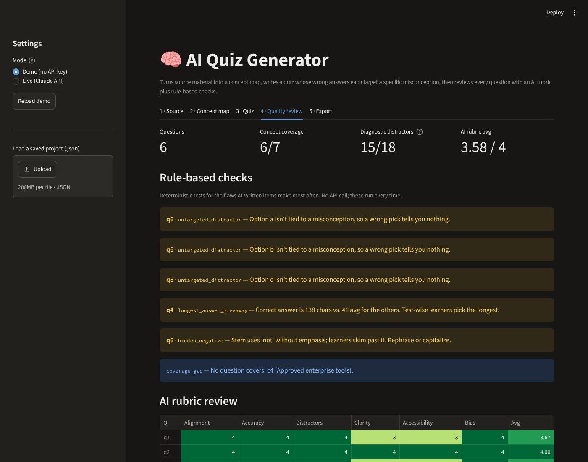

# AI Quiz Generator

[](https://github.com/G1NO/ai-quiz-generator/actions/workflows/tests.yml)

Turns training content into a draft multiple-choice quiz using AI, and then **checks the questions the way an instructional designer would**.

It has two modes:

| | **Quick mode** (`quizgen generate`) | **Diagnostic mode** (web app + `quizgen diagnose`) |
|---|---|---|
| What you get | A clean quiz fast | A concept map, then a quiz where every wrong answer targets a known misconception |
| Review | Item-writing checks | Item-writing checks + structural checks + AI rubric review |
| Models | Claude or OpenAI | Claude |
| Dependencies | None (standard library) | Optional extras |

---

## Diagnostic mode

**[Try the web app →](#)** *(Streamlit link goes here)*



Most AI quiz tools give you questions with random filler distractors. If a learner picks a wrong one, you learn nothing about *why*. Diagnostic mode maps the content first:

1. **Concept map.** Learning objectives, key concepts, which concepts depend on which, and 1–3 misconceptions per concept (with why learners fall into them). You see it as a graph and can edit it before any questions are written. That's where an SME review belongs.
2. **Quiz.** Questions follow prerequisite order and lean toward apply/analyze. Every wrong option is tagged with the misconception it targets, so a wrong answer becomes a diagnosis. Every option gets its own feedback.
3. **Quality review, two ways.**
   - *AI rubric:* alignment, accuracy, distractor quality, clarity, accessibility, and bias, scored 1–4, with issues and suggested fixes.
   - *Rule-based checks:* longest-answer giveaways, hidden negatives, all/none of the above, distractors with no misconception or from the wrong concept, answer-key patterns, too much recall, coverage gaps, prerequisite order, broken references, and loops in the map.
   - Questions flagged by **both** reviewers get surfaced first. An LLM grading an LLM has blind spots; plain code catches the cheap stuff every time.
4. **Export.** Moodle GIFT, CSV, Markdown for SME review, or the full project as JSON to reload later.



The bundled demo has a few flaws on purpose so you can watch both reviewers catch them.

### Run the web app

```bash
pip install -r requirements.txt
streamlit run app.py
```

Demo mode works without a key. For live mode, paste an [Anthropic API key](https://console.anthropic.com/) in the sidebar, or set `ANTHROPIC_API_KEY` (env var or `.streamlit/secrets.toml`).

### Or from the command line

```bash
pip install ".[diagnostic]"
quizgen diagnose examples/diagnostic/ai-at-work.txt --demo          # offline example
quizgen diagnose my-training.md -n 8 -a "new hires" -f md -f gift    # live, needs ANTHROPIC_API_KEY
```

---

## Quick mode

Most AI quiz tools stop at "here are some questions." This one is built around item-writing best practices:

- Every question is tied to a **learning objective** and a **Bloom's taxonomy level**
- Every answer choice gets **feedback that explains why** it's right or wrong
- A built-in **quality checker** flags common item-writing mistakes before a learner ever sees them
- Exports to **Markdown, CSV, Moodle GIFT, JSON** and a **clickable HTML quiz**

AI writes the first draft. A human reviews and approves it. The tool makes that review faster by pointing out exactly what to look at.

---

## Try it in 30 seconds (no API key needed)

```bash
git clone https://github.com/G1NO/ai-quiz-generator.git
cd ai-quiz-generator
pip install .
quizgen generate examples/sample-training.md --demo
```

`--demo` runs the whole pipeline (parsing, validation, quality checks and export) with a built-in sample response instead of calling an AI model. It writes `quiz.md` and `quiz.html`. Open `quiz.html` in a browser to take the quiz.

## Use it with a real model

```bash
pip install ".[anthropic]"          # or ".[openai]"
export ANTHROPIC_API_KEY=sk-...     # or OPENAI_API_KEY

quizgen generate my-training.md -n 8 \
  --level apply \
  --audience "new customer service hires" \
  -o "Learners will be able to de-escalate an upset caller" \
  -o "Learners will be able to log a complaint correctly" \
  -f md -f gift -f csv \
  --out output/customer-service-quiz
```

### Options

| Option | What it does |
|---|---|
| `-n, --num` | Number of questions, 1–25 (default 5) |
| `-l, --level` | Target Bloom's level: `remember`, `understand`, `apply`, `analyze`, `evaluate`, `create` (default: a mix) |
| `-o, --objective` | A learning objective to align questions to. Repeat for more. |
| `-a, --audience` | Who the training is for, so scenarios fit the learners |
| `-f, --format` | `md`, `html`, `csv`, `gift`, `json`. Repeat for more. (default: `md` and `html`) |
| `-t, --title` | Quiz title (default: based on the file name) |
| `--out` | Output path without extension (default: `quiz`) |
| `--provider` | `anthropic` (default) or `openai` |
| `--model` | Override the model (or set `QUIZGEN_MODEL`) |
| `--demo` | Run offline with the built-in sample response |

## The quality checker

After the AI responds, every question is validated (exactly one correct answer, 3–5 options, feedback on every option, a valid Bloom's level) and then reviewed for these item-writing problems:

| Check | Why it matters |
|---|---|
| "All / none of the above" | Learners can guess from partial knowledge |
| Negative stems (NOT, EXCEPT) | Easy to misread, so they test reading instead of knowledge |
| Correct answer much longer than the distractors | Length gives the answer away |
| Duplicate options or questions | Wasted items |
| Absolutes ("always", "never") only in distractors | Test-wise learners rule them out |
| Thin feedback ("Correct." / "Incorrect.") | Doesn't teach anything |
| No learning objective | Can't tell what the question measures |

Questions that break the hard rules are dropped and reported. Questions with quality issues are kept but **flagged for human review** in the Markdown and CSV output:

> ⚠️ **Review:** Uses "all/none of the above". These let learners guess from partial knowledge. Negative stem (NOT/EXCEPT/LEAST). Learners often misread these; rephrase if you can. Correct answer is much longer than the others. Length can give the answer away.

The demo response includes one deliberately flawed question so you can see this in action.

## Example output

From [`examples/sample-training.md`](examples/sample-training.md), a short guide on using AI at work. See all formats in [`examples/`](examples/).

> **2. Jordan needs to tell a long-time client their order is delayed one week by a supplier. Which prompt will get the most usable first draft?**
> *Objective: Learners will be able to write a prompt that includes a goal, context and format · Bloom's level: apply*
>
> - **A.** "Write an email to our client about their order being delayed by our supplier."
> - **B.** "Write a short apology email to a long-time client about a one-week supplier delay. Warm, under 120 words." ✅
> - **C.** "Write a professional email that is warm, friendly and under 120 words, with a helpful tone."
> - **D.** "Our supplier delayed a long-time client's order by one week, and they are a valued customer."
>
> **Feedback**
> - **A:** It has a goal and some context, but no format, so the AI has to guess the tone and length.
> - **B:** It has a clear goal, the context (who, what, why) and the format (tone and length).
> - **C:** Format only. The AI doesn't know what happened or who the email is for.
> - **D:** Context only. There's no goal, so the AI doesn't know what you want it to write.

*The example files were produced with `--demo`, so they show the tool's real formatting and quality checks on a fixed sample response.*

## Export formats

| Format | Use it for |
|---|---|
| `md` | Reviewing with an answer key, feedback and review notes |
| `html` | A self-contained, clickable quiz with instant feedback. Email it or host it anywhere. |
| `gift` | Importing straight into **Moodle** (includes per-answer feedback) |
| `csv` | Spreadsheets, SME review, or LMS bulk import |
| `json` | Feeding into other tools |

## How it works

```
training content ──► prompt built from item-writing rules ──► AI model
                                                                │
         export ◄── quality review ◄── validation ◄── JSON parsed
```

| File | Job |
|---|---|
| `quizgen/generator.py` | Builds the prompt, calls the model, parses the JSON |
| `quizgen/models.py` | Question data model and structural validation |
| `quizgen/quality.py` | Item-writing quality checks |
| `quizgen/exporters.py` | Markdown, CSV, GIFT, JSON and HTML output |
| `quizgen/llm.py` | Small provider wrappers (Anthropic, OpenAI) |
| `quizgen/cli.py` | Command-line interface |
| `quizgen/diagnostic/schemas.py` | Diagnostic mode: Pydantic models for the concept map, quiz, and review |
| `quizgen/diagnostic/llm.py` | Claude wrapper: forced tool use for structured output, retries with the validation error |
| `quizgen/diagnostic/pipeline.py` | The three stages: map, quiz, review |
| `quizgen/diagnostic/checks.py` | Rule-based structural and item-writing checks |
| `quizgen/diagnostic/graph.py`, `export.py` | Concept map graph; GIFT/CSV/Markdown/JSON |
| `app.py` | Streamlit web app |

Design choices:
- **No required dependencies.** Quick mode runs on the Python standard library. AI SDKs and diagnostic mode are optional extras.
- **Provider-agnostic.** Each provider is one small class with a single `complete()` method, so adding another is easy and testing is simple.
- **Fails safely.** Malformed AI output is caught, bad questions are dropped with a clear reason, and errors print as plain messages, not stack traces.

## Running the tests

```bash
pip install ".[dev]"
pytest
```

The test suite covers validation, every quality check, JSON parsing edge cases, all export formats (including GIFT escaping and HTML injection safety) and the CLI, using a fake model client so no API key is needed. Tests also run automatically on GitHub for every push.

## Limitations

- AI can still produce questions that are technically valid but not quite right for your content. **Always have a human review the draft**, which is the point of the review flags.
- Very long source documents are trimmed to about 60,000 characters. For long courses, run it one module at a time.

## About

Built by **Gino DeFalco**, an instructional designer who builds technical and AI training, and a US Army veteran.

- Portfolio: [ginodefalco.com](https://ginodefalco.com)
- LinkedIn: [linkedin.com/in/gino-defalco](https://www.linkedin.com/in/gino-defalco)

Licensed under the [MIT License](LICENSE).
